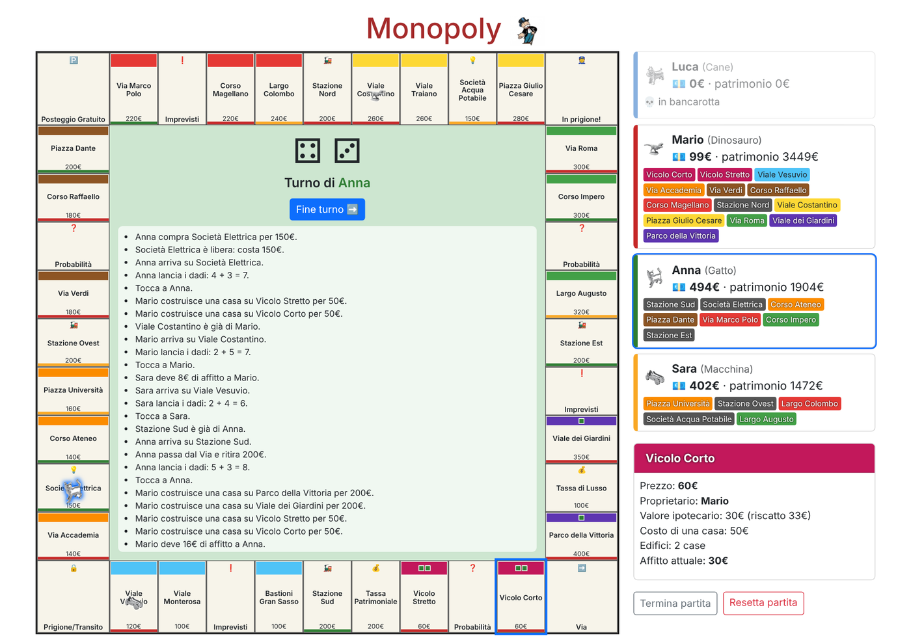
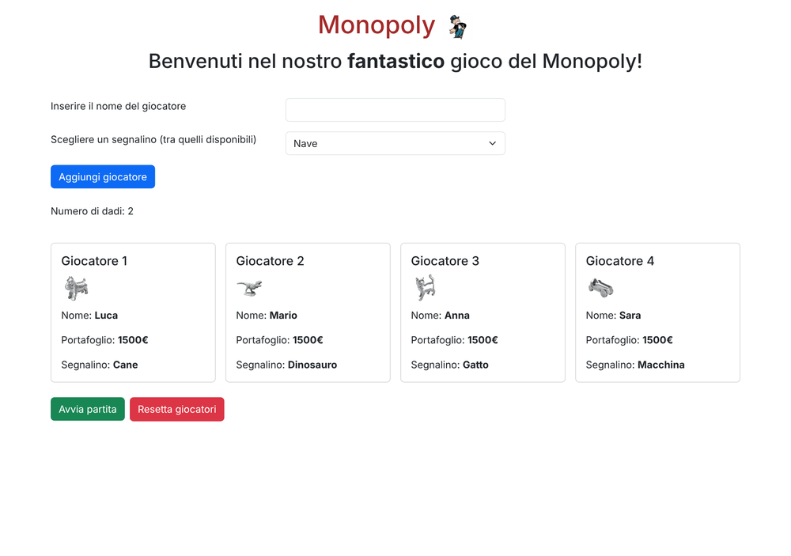
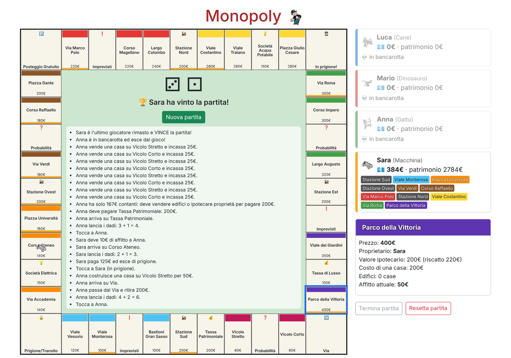
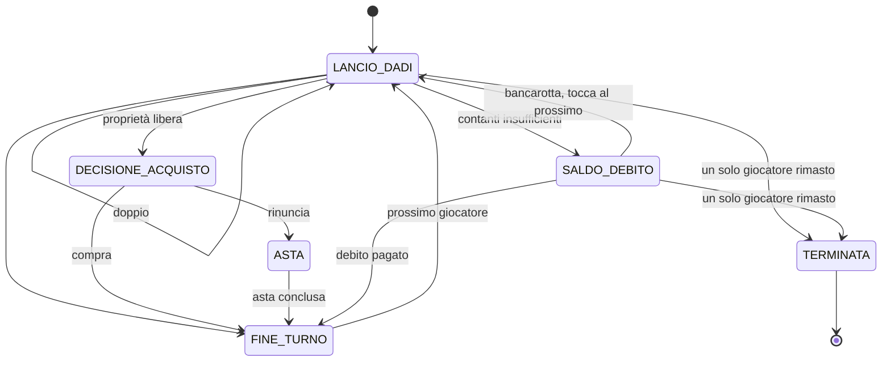

# Monopoly

[](https://github.com/lukeharley/monopoly/actions/workflows/ci.yml)

Il Monopoly nella **versione italiana in euro**, giocabile nel browser da 2 a 8 giocatori.
Applicazione web **Java 17 + Spring Boot 3**: le regole stanno sul server, l'interfaccia è una pagina
HTML/JavaScript che mostra il tabellone e invia le mosse.



## Caratteristiche

- 🎲 **Partita completa**: turni, dadi con doppi, acquisti, aste, affitti, case e alberghi, ipoteche,
  Imprevisti e Probabilità, prigione, debiti, bancarotta e vittoria.
- 🖥️ **Tabellone interattivo**: segnalini, edifici, colore del proprietario, registro degli eventi;
  cliccando una casella se ne vedono i dettagli e si gestiscono le proprie proprietà.
- 🌐 **Multi-dispositivo**: più persone possono aprire la stessa partita e ogni schermata si aggiorna da sola.
  Una mossa decisa su uno stato ormai superato viene rifiutata invece di essere applicata.
- ✅ **Testato**: test delle regole e test d'integrazione dell'API, eseguiti dalla CI a ogni push.

## Avvio rapido

Serve **Java 17** o superiore con **Maven**.

```bash
# senza installare nulla: database H2 in memoria
mvn spring-boot:run -Dspring-boot.run.profiles=dev
```

Poi apri http://localhost:8080.

<details>
<summary>Con MySQL</summary>

Le credenziali si leggono dalle variabili d'ambiente (in VS Code si possono mettere nel file `.env`,
già escluso da git e letto dalla configurazione di avvio):

| Variabile | Predefinito |
|---|---|
| `DB_URL` | `jdbc:mysql://localhost:3306/monopoly?createDatabaseIfNotExist=true` |
| `DB_USERNAME` | `luke` |
| `DB_PASSWORD` | *(vuota)* |

```bash
DB_PASSWORD=la-tua-password mvn spring-boot:run
```
</details>

<details>
<summary>Online con GitHub Codespaces</summary>

[](https://codespaces.new/lukeharley/monopoly)

1. Apri il Codespace con il pulsante qui sopra (oppure **Code → Codespaces → Create codespace**).
2. La configurazione in [`.devcontainer`](.devcontainer/devcontainer.json) installa Java e Maven e avvia il gioco
   da sola; alla fine si apre il browser sulla porta **8080**.
3. Per far giocare altre persone: scheda *Ports* → tasto destro sulla porta 8080 →
   **Port Visibility → Public**, poi condividi il link.
</details>

## Come si gioca

1. Registra da 2 a 8 giocatori, ognuno con un nome e un segnalino diverso, poi premi **Avvia partita**.
2. Al proprio turno ogni giocatore:
   - **lancia i dadi**; con un doppio rilancia, al terzo doppio consecutivo va in prigione;
   - se arriva su una proprietà libera la **compra** oppure la manda **all'asta**;
   - paga affitti e tasse, oppure pesca una carta;
   - in qualsiasi momento del turno può **costruire**, **vendere edifici**, **ipotecare** o **riscattare**
     le proprie proprietà, cliccandole sul tabellone o nel proprio pannello;
   - preme **Fine turno**.
3. Vince l'ultimo giocatore non in bancarotta. **Termina partita** chiude prima la partita e proclama vincitore
   chi ha il patrimonio più alto.

| Lobby | Fine partita |
|---|---|
|  |  |

## Regole implementate

| Regola | Come funziona |
|---|---|
| Partenza | 1500 € a testa; passando dal Via si ritirano 200 € |
| Dadi | Due dadi; con un doppio si rilancia, al terzo doppio consecutivo si va in prigione |
| Acquisto e asta | L'acquisto è facoltativo; se il giocatore rinuncia, la proprietà va all'asta tra tutti i giocatori (senza offerte resta alla banca) |
| Affitti dei terreni | Rendite ufficiali dei contratti (terreno, 1-4 case, albergo); terreno senza case a rendita doppia con il monopolio del colore |
| Stazioni e società | Stazioni 25/50/100/200 € secondo quante se ne possiedono; società 4 volte i dadi, 10 volte con entrambe |
| Case e alberghi | Solo con il monopolio del colore e senza terreni ipotecati nel gruppo; costruzione e vendita uniformi; scorte di 32 case e 12 alberghi; vendita alla banca a metà prezzo |
| Ipoteche | Si incassa metà del prezzo; riscatto = ipoteca + 10%; una proprietà ipotecata non rende |
| Carte | 16 Imprevisti e 16 Probabilità mescolati, tra cui "Uscite gratis di prigione" e le riparazioni per case e alberghi |
| Tasse | Patrimoniale 200 €, di Lusso 100 € |
| Prigione | Si esce pagando 125 €, usando la carta o facendo un doppio; al terzo tentativo fallito si paga la multa e si esce |
| Debiti | Se i contanti non bastano, il giocatore sceglie quali edifici vendere e cosa ipotecare, poi paga oppure dichiara bancarotta |
| Bancarotta | Automatica se nemmeno vendendo tutto si raggiunge la somma; gli edifici tornano alla banca, denaro e proprietà al creditore (o alla banca) |

Non ancora implementati: scambi di proprietà tra giocatori, limite di tempo della partita.

## Architettura

```
src/main/java/com/luca/monopoly
├── HomeController, AjaxHomeController   web: lobby (form) e API JSON delle mosse
├── GestoreErroriApi                     web: eccezioni → codici HTTP
├── StatoPartitaView                     web: fotografia JSON della partita
├── service/                             partita condivisa, lock, versione, persistenza
├── repository/                          giocatori registrati (JPA)
└── domain/                              regole del gioco, indipendenti da Spring
    ├── Partita                          turni e fasi
    ├── Asta, Debito                     asta in corso, debito da saldare
    ├── CalcolatoreAffitto               affitti
    ├── GestoreProprieta                 case, alberghi, ipoteche
    └── Tabellone, Casella, Contratto, Mazzo, Carta, Banca, Dado, ...
```

Il turno è una **macchina a stati** (`FasePartita`); ogni mossa è ammessa solo nella fase giusta:



Dopo un acquisto, un'asta o un debito pagato si torna a `LANCIO_DADI` se era uscito un doppio.

### API

La pagina chiama questi endpoint; ogni mossa risponde con il nuovo stato completo in JSON.

| Metodo | Percorso | Azione |
|---|---|---|
| `GET` | `/stato?versione=N` | Stato della partita (`204` se la versione `N` è ancora quella attuale) |
| `POST` | `/lanciaDadi`, `/fineTurno` | Lancio dei dadi, passaggio del turno |
| `POST` | `/compraProprieta`, `/rifiutaAcquisto` | Acquisto oppure avvio dell'asta |
| `POST` | `/offerta?importo=N`, `/ritiratiDallAsta` | Asta |
| `POST` | `/pagaDebito`, `/dichiaraBancarotta` | Saldo del debito |
| `POST` | `/pagaUscitaDiPrigione`, `/usaCartaUscitaDiPrigione` | Uscita di prigione |
| `POST` | `/costruisciCasetta/{pos}`, `/vendiCasetta/{pos}` | Edifici sulla casella `pos` (0-39) |
| `POST` | `/ipoteca/{pos}`, `/riscattaIpoteca/{pos}` | Ipoteche |
| `POST` | `/terminaPartita` | Chiusura anticipata della partita |

Ogni `POST` accetta il parametro facoltativo `versione`. Codici di risposta:

| Codice | Significato |
|---|---|
| `200` | Mossa eseguita |
| `400` | Parametri non validi |
| `404` | Nessuna partita in corso |
| `409` | La partita è cambiata nel frattempo: aggiornare lo stato e riprovare |
| `422` | Mossa non ammessa dalle regole (il messaggio è nel campo `errore`) |

La lobby usa form classici: `POST /` aggiunge un giocatore, `POST /avviaPartita` avvia la partita,
`POST /resettaPartita` cancella partita e giocatori.

## Test

```bash
mvn verify
```

- `PartitaTest`: regole del gioco con dadi e mazzi deterministici (doppi, prigione, affitti, aste, debiti, bancarotta...).
- `MonopolyTest`: contenuto della scatola (caselle, contratti, carte, case, alberghi, dadi).
- `ApiPartitaIntegrationTest`: l'API HTTP sul database H2, inclusi i conflitti di versione.

La CI di GitHub Actions ([`.github/workflows/ci.yml`](.github/workflows/ci.yml)) esegue gli stessi test a ogni push.

## Limiti noti

- Il server gestisce **una sola partita** alla volta, condivisa da chiunque apra il sito.
- Non ci sono account: chi apre la pagina può muovere per il giocatore di turno (pensato per giocare insieme).
- Con il profilo `dev` i dati sono in memoria e si perdono al riavvio.

## Fonti

- Regolamento: https://www.giochi-da-tavolo.it/monpoli-istruzioni-regole/
- Tabellone e prezzi delle proprietà (edizione in euro): https://it.wikipedia.org/wiki/Monopoly
- Imprevisti e Probabilità: https://answerprime.com/monopoli-elenco-imprevisti-probabilita10pt-2/
- Contratti: https://it.scribd.com/document/327938771/Contratti-Monopoli

---

Il repository contiene anche **CustomScraper**, un modulo separato e indipendente dal gioco
(navigazione di siti, estrazione e matching di prodotti): vedi [CUSTOM_SCRAPER.md](CUSTOM_SCRAPER.md).
