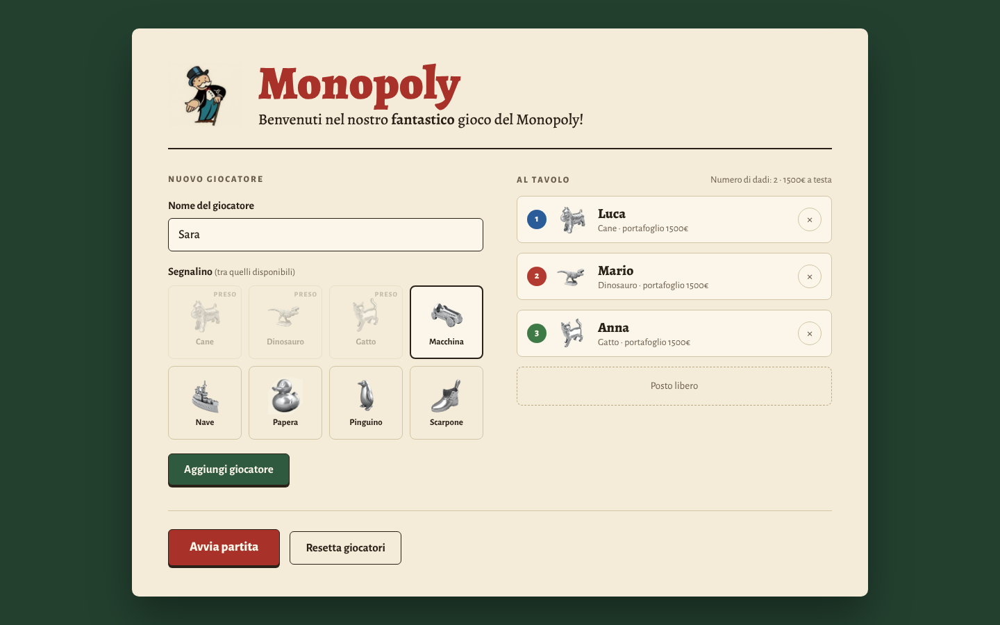
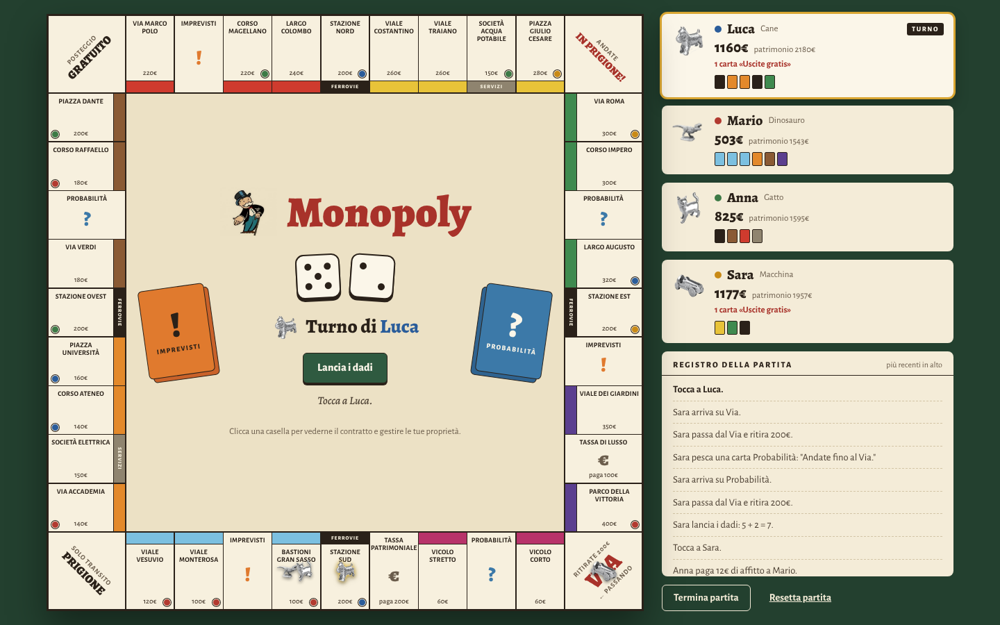
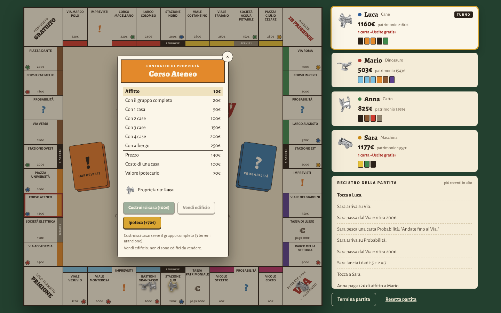
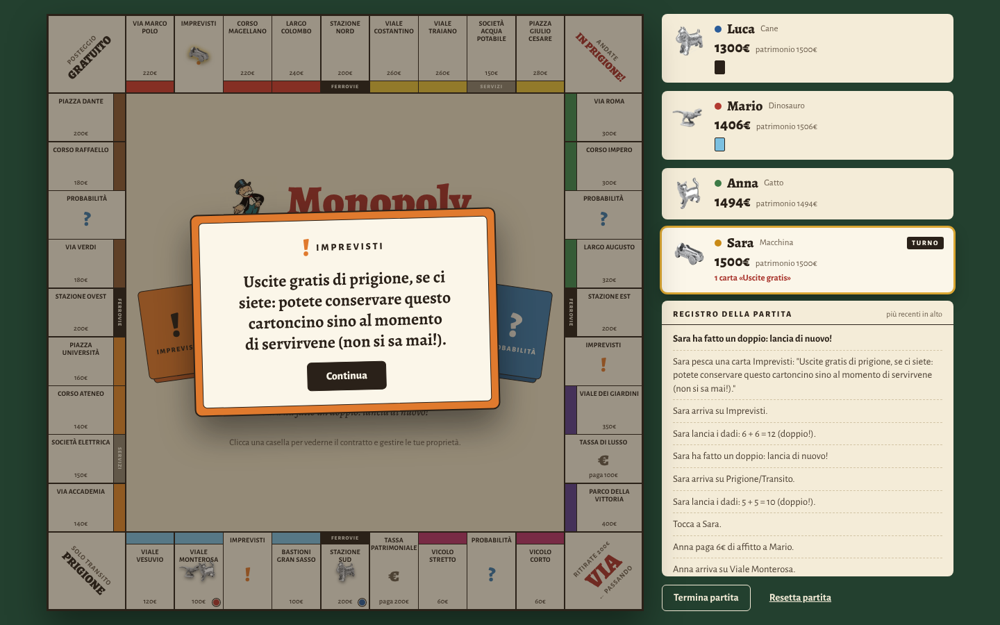
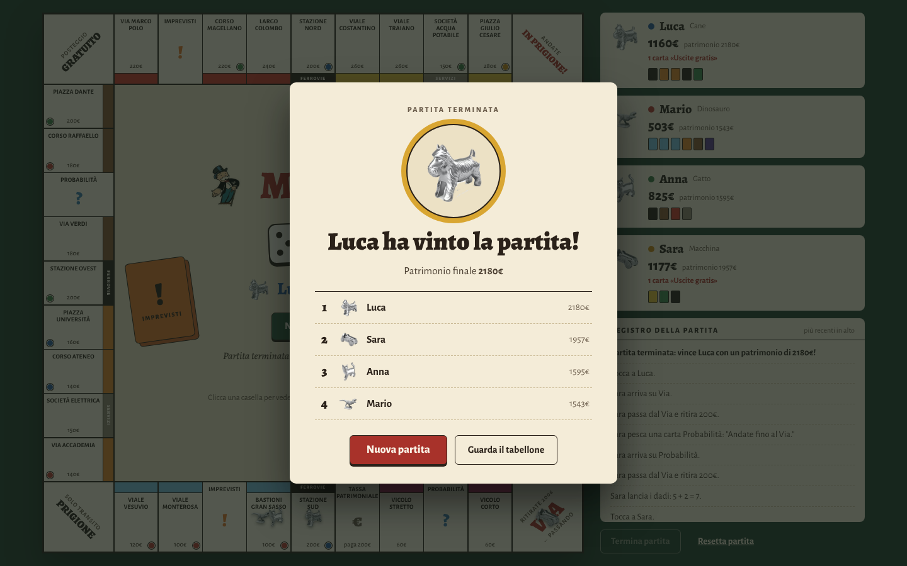

# monopoly

## Come avviare il gioco

- Con MySQL (configurazione in `application.yml`): `mvn spring-boot:run`
- Senza MySQL, con database H2 in memoria: `mvn spring-boot:run -Dspring-boot.run.profiles=dev`

Poi aprire http://localhost:8080, registrare da 2 a 8 giocatori (nome + segnalino) e premere **Avvia partita**.
Si gioca a turni sullo stesso computer: il giocatore di turno lancia i dadi, decide se comprare la proprietà libera,
gestisce le proprie proprietà cliccando le caselle del tabellone (case, alberghi, ipoteche) e infine passa il turno.

Test: `mvn test`

## Interfaccia

Stile "Tavolo": panno verde, tabellone color crema, titoli in serif. Pensata per schermi desktop (il tabellone non scende sotto 720px).

**Setup giocatori**: nome, scelta del segnalino tra quelli liberi, posti al tavolo con il pulsante × per togliere un giocatore.

**Partita in corso**: tabellone con case, alberghi, pallino del proprietario e ipoteche; dadi, turno e azioni al centro;
giocatori e registro della partita nella barra laterale.

**Contratto di proprietà**: si apre cliccando una casella. Mostra la tabella degli affitti con l'affitto attuale evidenziato;
le azioni non consentite (costruire senza il gruppo completo, vendere in modo non uniforme...) restano disattivate e il motivo compare sotto.

**Carte Imprevisti e Probabilità** e **fine partita** con la classifica.

## Regole implementate

- Lancio di 2 dadi; con un doppio si rilancia, al terzo doppio consecutivo si va in prigione.
- Passaggio dal Via: +200€.
- Acquisto facoltativo di terreni, stazioni e società.
- Affitti versati al proprietario: terreno (doppio con il monopolio del colore), case e alberghi secondo i Contratti,
  stazioni 25/50/100/200€, società 4 o 10 volte il risultato dei dadi. Le proprietà ipotecate non rendono.
- Costruzione uniforme di case e alberghi (solo con il monopolio e nessun terreno del gruppo ipotecato),
  vendita alla banca a metà prezzo, scorte limitate di 32 case e 12 alberghi.
- Ipoteca (metà del prezzo) e riscatto (ipoteca + 10%).
- 16 Imprevisti e 16 Probabilità mescolati, incluse "Uscite gratis di prigione" e riparazioni per case/alberghi.
- Prigione: multa di 125€, carta "Uscite gratis", oppure doppio; al terzo tentativo fallito si paga e si esce.
- Tasse: Patrimoniale 200€, di Lusso 100€.
- Debiti: se mancano i contanti, il gioco vende automaticamente gli edifici e ipoteca le proprietà;
  se non basta il giocatore va in bancarotta (i beni passano al creditore o tornano alla banca).
- Vince l'ultimo giocatore rimasto, oppure (pulsante **Termina partita**) chi ha il patrimonio più alto.

Non implementati: aste, scambi tra giocatori.

## Note di progetto

Fonti
Regolamento:
https://www.giochi-da-tavolo.it/monpoli-istruzioni-regole/

Tabellone e costi delle singole proprietà:
https://it.wikipedia.org/wiki/Monopoly#:~:text=Giochi%20(in%20euro)-,Posteggio%20gratuito,-Via%20Marco%20Polo

Imprevisti e Probabilità: https://answerprime.com/monopoli-elenco-imprevisti-probabilita10pt-2/

Contratti (Campione): https://it.scribd.com/document/327938771/Contratti-Monopoli
https://www.giochi-da-tavolo.it/monpoli-istruzioni-regole/#:~:text=PAGARE%20RENDITE%20E%20AFFITTI
ricerca dei restanti contratti su Google Immagini e conversione dei valori da lire in euro (diviso 40)

Sviluppo del gioco Monopoly
Scopo del gioco:

1. Diventare il giocatore più ricco dopo un certo tempo: dal momento in cui comincia la partita, cominciare a calcolare il passare del tempo. Nel momento in cui sono state raggiunte le 3 ore di gioco, il gioco si interrompe e il giocatore con più soldi VINCE. [POSTICIPATO]
2. Quando un giocatore deve pagare più soldi di quelli posseduti va in bancarotta ed esce dal gioco. Quando rimane un solo giocatore, prima che siano trascorse le 3 ore, il giocatore rimasto VINCE. [POSTICIPATO]
3. ~~Rappresentare il contenuto della scatola del Monopoly: 1 tabellone, 8 segnalini, 28 contratti, 16 carte "Imprevisti", 16 carte "Probabilità", 32 case, 12 alberghi, 2 dadi.~~
   [FATTO]
4. ~~Conto di partenza di ogni giocatore (= Patrimonio): 2 _ 500€ + 4 _ 100€ + 50€ + 20€ + 2 _ 10€ + 5€ + 5 _ 1€. Per un totale di 1500€.~~ [FATTO]
5. ~~Ad ogni turno il giocatore lancia i dadi e ottiene un valore che fa muovere i segnalini dei giocatori (shift = valore ottenuto come risultato del lancio dei dadi).~~ [FATTO]
   ~~Terminate/oltrepassate le 40 posizioni del tabellone, si ottengono i 500€ del Via! e il giro ricomincia da 0)~~ [FATTO]
   (Se si ottengono 2 numeri uguali per le 2 facce, il giocatore ripete il turno. [POSTICIPATO]
   Dopo 3 volte che ciò accade, il giocatore finisce in prigione senza passare dal Via! [= senza ritirare i 500€, non vale il ricalcolo delle posizioni delle caselle].) [POSTICIPATO]
6. In base alla casella su cui si arriva, si potranno effettuare le seguenti azioni:
   a) ~~Acquistare la proprietà/il terreno (se ancora disponibili)~~ [FATTO] e, se si ottengono tutti i terreni di uno stesso colore, posizionare le case e quindi gli alberghi (se possibile): il costo (da saldare alla banca) è stabilito nelle carte dei Contratti.
   [Se si completa il numero di terreni dello stesso colore (= si ha un Monopolio) la rendita del solo terreno raddoppia e si sblocca la possibilità di posizionare case e poi alberghi]
   b) ~~Pagare l'affitto/la rendita (se la proprietà è posseduta da un altro giocatore): il prezzo (da pagare alla banca) è stabilito nelle carte dei Contratti e dipende dal numero di case e alberghi~~ [FATTO]
   c) ~~Se la casella è di tipo imprevisto o probabilità (String.equals()). Pescare una carta "Imprevisti" o "Probabilità" e registrare l'effetto in base alle variabili cotenute nel testo della rispettiva carta.~~
   d) ~~Se la casella è una stazione o società elettrica pagare la tassa: il costo è stabilito nelle carte dei Contratti.~~
   e) ~~Andare in prigione~~
   f) ~~Se la casella è Posteggio gratuito" non accade niente~~
   g) ~~Se la casella è il "Via!" si ritira un premio in denaro: es. 500€~~ [FATTO]
   h) Se la casella è "In prigione!" il giocatore finisce in prigione.
7. ACQUISTARE PROPRIETA’, CASE E ALBERGHI
   Se si riescono ad ottenere tutti i terreni dello stesso colore, è possibile comprare case al prezzo indicato sul Contratto. Va ricordato che si è obbligati a costruire in maniera proporzionata: non si potrà costruire una seconda casa se prima non si è costruito una casa su ognuno dei terreni di quel gruppo.
8. Potete comprare tanti edifici quanti volete nello stesso turno, a patto che siate in grado di pagarli, ma non potete costruire su un terreno se uno qualsiasi degli altri terreni dello stesso gruppo è ipotecato.
9. Terreni all'asta
   VENDITA DELLE PROPRIETA’
   È possibile vendere Servizi, Stazioni e Terreni a un qualunque altro giocatore mettendoli all’asta in qualsiasi momento. E’ importante ricordare che i terreni si possono vendere solo “nudi”, senza edifici. Se sono presenti case o alberghi andranno venduti alla metà del prezzo d’acquisto alla banca, prima di procedere con la vendita della nuda proprietà del terreno.
10. Ipoteche sulle proprietà
    È possibile ipotecare una proprietà incassando dalla banca quello che sul Contratto è definito “Valore Ipotecario”. Servizi, Stazioni e Terreni ipotecati rimangono di proprietà, e nessun altro giocatore potrà cancellare le ipoteche per impossessarsene. Le proprietà ipotecate vanno girate mostrando il retro del Contratto. Questa proprietà ipotecata non rende più nessun affitto. Tuttavia se si possiedono tutti i terreni di uno stesso colore, (Monopolio) è possibile incassare il doppio dell’affitto dovuto per la sosta su un terreno non ipotecato, anche se gli altri due terreni del medesimo colore sono ipotecati.
    Per annullare l’ipoteca è sufficiente pagare il vaore originario dell’ipoteca + il 10% di interessi alla banca. Il contratto si rigirerà a fascia in su e sarà possibile riguadagnare rendite da tale proprietà.
11. Per uscire di prigione
    Chi si trova in PRIGIONE può uscirne in uno dei seguenti modi:
12. mediante il pagamento di € 125 al suo prossimo turno, prima di lanciare i dadi
13. ottenendo un punteggio doppio con i dadi senza dover pagare nulla. In questo caso deve muovere il segnalino di un numero di caselle pari al punteggio ottenuto
14. utilizzando uno dei cartoncini sui quali è scritto USCITE GRATIS DI PRIGIONE
    Ad ogni turno trascorso in Prigione, il giocatore deve comunque lanciare i dadi. Se esce un “doppio” esce, altrimenti no. Dopo 3 turni il giocatore è costretto a pagare € 125 di multa e uscire, utilizzando per il movimento l’ultimo punteggio ottenuto.

# monopoly
